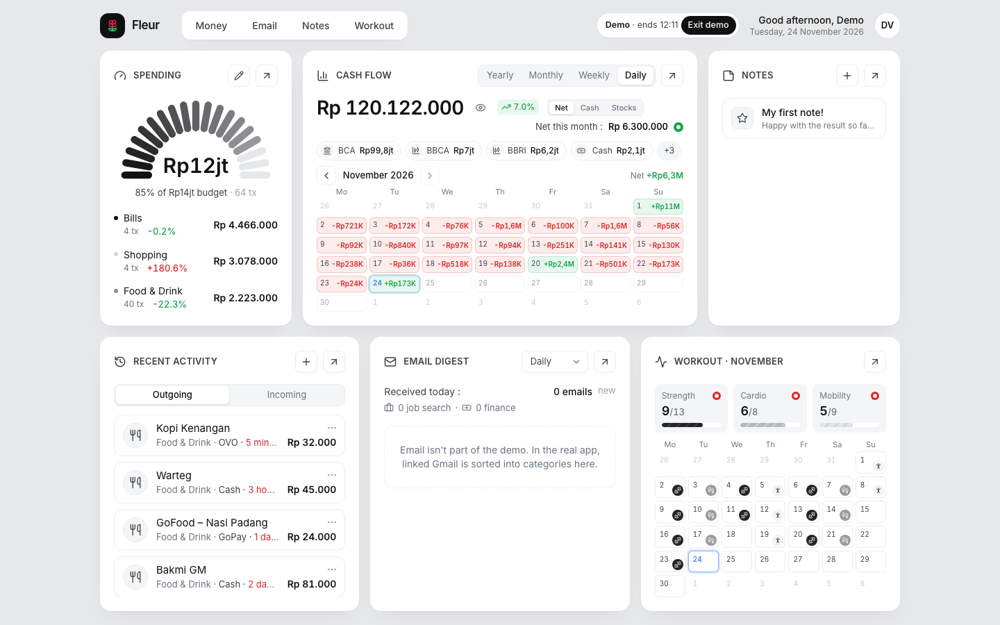
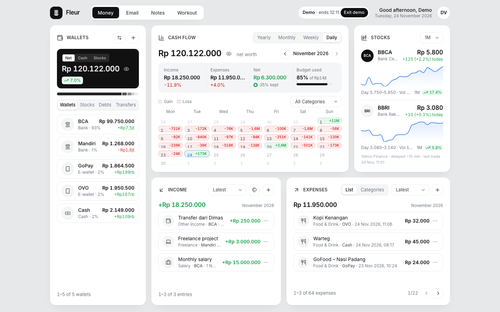
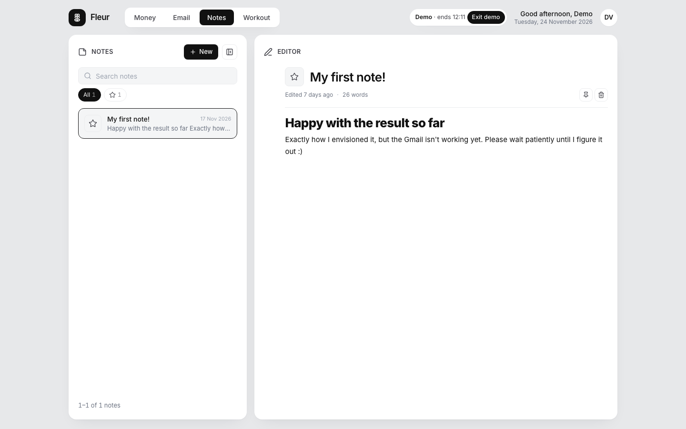
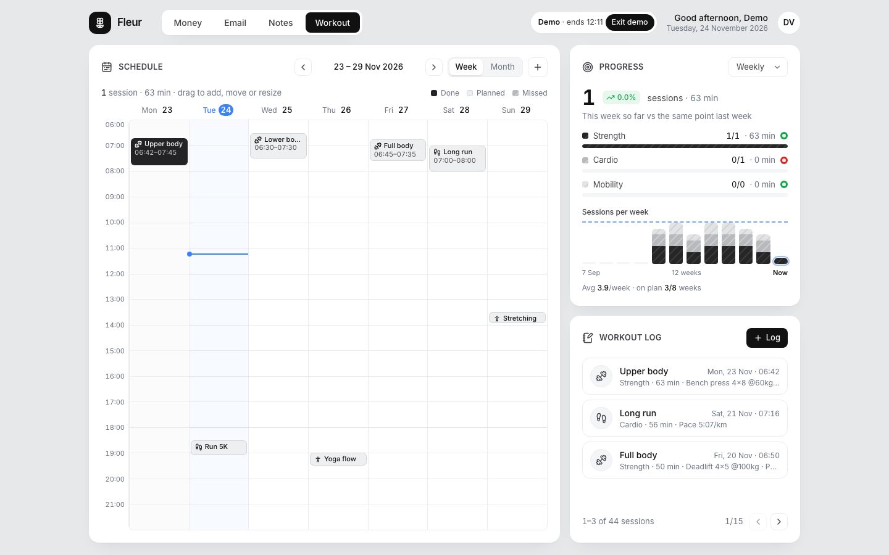
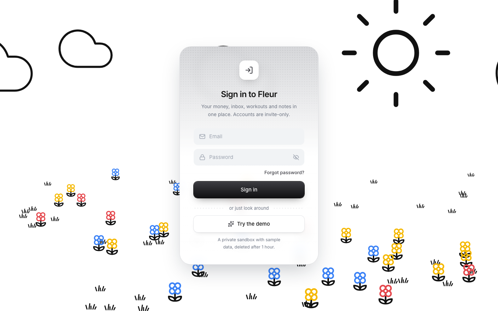

# Fleur

A personal dashboard for the things I check every day: **money, email, notes and workouts**, on one calm screen.

**[Live demo →](https://YOUR-APP.vercel.app)** Click **Try the demo** on the sign-in page. You get a private sandbox full of sample data, and it's deleted after an hour.



## Features

### Overview
Spending against the monthly budget, net worth and cash flow (yearly, monthly, weekly or daily), recent activity, notes, an email digest and the workout month, all on one page.

### Money


- **Wallets** for banks, e-wallets and cash. Balances come from income, expenses and transfers between wallets.
- **Stocks** (BBCA, BBRI) valued at live IDX prices. **Debts and subscriptions** with their next due date.
- **Cash flow** by year, month, week or day, with a calendar of each day's gain or loss.
- Income and expense lists, categories and a monthly budget.

### Notes


A Notion-style editor: Markdown shortcuts as you type, a floating toolbar, draggable blocks, tables, checklists and images. Notes autosave and are stored as plain Markdown.

### Workout


- A Google Calendar-style weekly plan: drag to add, move or resize sessions.
- A month view and a workout log.
- Weekly progress per type (strength, cardio, mobility), with done and missed sessions.

### Email *(in progress)*
Link a Gmail inbox (read-only). Fleur sorts mail into categories (job search, finance, work, …) and turns bank and e-wallet notifications into transactions. The parsers are still being tuned on real emails, so Email isn't part of the demo.

### Sign-in


Invite-only accounts, plus a **Try the demo** button. The background is drawn in code: a line-art meadow with a sun and drifting clouds.

## How it's built

| | |
|---|---|
| **App** | Next.js 15 (App Router, server components, server actions), TypeScript, Tailwind CSS v4, Recharts, Tiptap |
| **Data** | PostgreSQL with Drizzle ORM. Supabase in production, local Postgres in development |
| **Auth** | Better Auth (email and password, sessions in Postgres, rate-limited sign-in) |
| **Hosting** | Vercel (Singapore region, next to the database) |
| **Jobs** | Vercel Cron (daily Gmail sync) and Supabase pg_cron (demo cleanup every 10 minutes) |

A few things I cared about:

- **Private by design.** Every row belongs to one user and every query filters by it. Composite foreign keys stop a row from pointing at someone else's data, and row-level security closes Supabase's public API.
- **Time zones done right.** "Today", "this month" and budgets follow each user's time zone, not the server's (Vercel runs in UTC).
- **A real demo, safely.** Each demo visitor gets their own throwaway account with about a year of generated data. Nobody sees anyone else's changes, and the database deletes sandboxes after an hour.
- **One screen, no scrolling** on desktop. Lists page through what doesn't fit. On phones, the cards stack.

## Run it locally

Needs Node 22.9+ and PostgreSQL.

```bash
npm install
createuser fleur --pwprompt && createdb -O fleur fleur
cp .env.example .env.local        # fill in DATABASE_URL, BETTER_AUTH_SECRET, BETTER_AUTH_URL
npm run db:migrate
npm run user:create -- --email you@example.com --name "Your Name"   # prints a temporary password
npm run dev                       # http://localhost:3000
```

Or click **Try the demo** on the sign-in page; no account is needed.
